# Project ER Diagram

This diagram reflects the Django models currently defined in the project. `PK`
identifies each model's database primary key; the UUID and human-readable IDs
shown alongside it are unique business identifiers.

```mermaid
erDiagram
    ORGANIZATION {
        bigint id PK
        uuid organization_id UK
        string organization_name
        string organization_type
        string registration_number UK
        string email
        string phone_number
        text address
        string state
        string district
        string pincode
        string verification_status
        file verification_document
        datetime created_at
        datetime updated_at
    }

    USER {
        bigint id PK
        uuid user_id UK
        string email UK
        string password
        string name
        string phone_number
        string role
        bigint organization_id FK
        boolean is_active
        boolean is_email_verified
        boolean is_staff
        boolean is_superuser
        datetime last_login
        datetime date_joined
        datetime created_at
        datetime updated_at
    }

    EMAIL_OTP {
        bigint id PK
        bigint user_id FK
        string purpose
        string otp_hash
        datetime expires_at
        smallint attempts
        datetime resend_available_at
        datetime used_at
        datetime created_at
    }

    ACTIVITY_LOG {
        bigint id PK
        uuid log_id UK
        bigint user_id FK
        string action
        string entity_type
        string entity_id
        text description
        string ip_address
        datetime created_at
    }

    BLOCKCHAIN_EVENT {
        bigint id PK
        uuid blockchain_event_id UK
        string entity_type
        string entity_id
        string event_type
        string transaction_hash
        bigint block_number
        string network_name
        string contract_address
        string data_hash
        string transaction_status
        datetime recorded_at
        datetime created_at
    }

    FARMER_PROFILE {
        bigint id PK
        uuid farmer_id UK
        bigint user_id FK,UK
        bigint organization_id FK
        string farmer_name
        string phone_number
        text address
        string village
        string district
        string state
        string pincode
        decimal land_area
        string land_record_reference
        string verification_status
        datetime created_at
        datetime updated_at
    }

    HERB_BATCH {
        bigint id PK
        string batch_id UK
        string herb_name
        string botanical_name
        text description
        decimal quantity
        string unit
        decimal available_quantity
        string source_type
        date collection_date
        time collection_time
        decimal latitude
        decimal longitude
        text collection_address
        string village
        string district
        string state
        bigint farmer_id FK
        bigint current_owner_id FK
        bigint organization_id FK
        string status
        text remarks
        string blockchain_record_id
        string blockchain_transaction_hash
        string blockchain_data_hash
        string blockchain_status
        datetime created_at
        datetime updated_at
    }

    COLLECTOR_PROFILE {
        bigint id PK
        uuid collector_id UK
        bigint user_id FK,UK
        bigint organization_id FK
        string collector_name
        string phone_number
        text address
        string verification_status
        datetime created_at
        datetime updated_at
    }

    TRANSFER_EVENT {
        bigint id PK
        uuid event_id UK
        bigint batch_id FK
        bigint from_party_id FK
        bigint to_party_id FK
        bigint from_organization_id FK
        bigint to_organization_id FK
        decimal quantity
        date transfer_date
        string transfer_location
        text remarks
        string status
        bigint recorded_by_id FK
        string blockchain_transaction_hash
        string blockchain_data_hash
        string blockchain_status
        datetime created_at
        datetime updated_at
    }

    LAB_PROFILE {
        bigint id PK
        uuid lab_id UK
        bigint user_id FK,UK
        bigint organization_id FK
        string laboratory_name
        string registration_number UK
        text address
        string contact_number
        string verification_status
        datetime created_at
        datetime updated_at
    }

    LAB_TEST {
        bigint id PK
        uuid test_id UK
        bigint batch_id FK
        bigint laboratory_id FK
        bigint submitted_by_id FK
        bigint reviewed_by_id FK
        date test_date
        string test_type
        json test_parameters
        text test_result
        text result_summary
        text remarks
        file certificate_file
        string certificate_hash
        string status
        string blockchain_transaction_hash
        string blockchain_data_hash
        string blockchain_status
        datetime created_at
        datetime updated_at
    }

    FACTORY_PROFILE {
        bigint id PK
        uuid factory_id UK
        bigint user_id FK,UK
        bigint organization_id FK
        string factory_name
        string registration_number UK
        text address
        string contact_number
        string verification_status
        datetime created_at
        datetime updated_at
    }

    MANUFACTURING_RECORD {
        bigint id PK
        uuid manufacturing_id UK
        bigint factory_id FK
        bigint created_by_id FK
        string product_name
        date process_date
        text process_description
        decimal input_quantity
        decimal output_quantity
        string unit
        string status
        text remarks
        string blockchain_transaction_hash
        string blockchain_data_hash
        string blockchain_status
        datetime created_at
        datetime updated_at
    }

    MANUFACTURING_BATCH {
        bigint id PK
        bigint manufacturing_record_id FK
        bigint herb_batch_id FK
        decimal quantity_used
        string unit
        datetime created_at
    }

    PRODUCT {
        bigint id PK
        uuid product_id UK
        string product_name
        text description
        string product_type
        bigint manufacturer_id FK
        bigint manufacturing_record_id FK
        date manufacture_date
        date expiry_date
        string batch_number UK
        decimal total_quantity
        string unit
        image product_image
        image qr_code_image
        string qr_reference UK
        string status
        string blockchain_transaction_hash
        string blockchain_data_hash
        string blockchain_status
        datetime created_at
        datetime updated_at
    }

    PRODUCT_BATCH {
        bigint id PK
        bigint product_id FK
        bigint herb_batch_id FK
        decimal quantity_used
        string unit
        datetime created_at
    }

    ORGANIZATION o|--o{ USER : employs
    USER ||--o| FARMER_PROFILE : has
    ORGANIZATION ||--o{ FARMER_PROFILE : groups
    FARMER_PROFILE ||--o{ HERB_BATCH : registers
    USER ||--o{ HERB_BATCH : currently_owns
    ORGANIZATION ||--o{ HERB_BATCH : records

    USER ||--o| COLLECTOR_PROFILE : has
    ORGANIZATION ||--o{ COLLECTOR_PROFILE : represents
    HERB_BATCH ||--o{ TRANSFER_EVENT : has_history
    USER ||--o{ TRANSFER_EVENT : sends_from
    USER ||--o{ TRANSFER_EVENT : receives_to
    USER ||--o{ TRANSFER_EVENT : records
    ORGANIZATION ||--o{ TRANSFER_EVENT : sends_from
    ORGANIZATION ||--o{ TRANSFER_EVENT : receives_to

    USER ||--o| LAB_PROFILE : has
    ORGANIZATION ||--o{ LAB_PROFILE : operates
    HERB_BATCH ||--o{ LAB_TEST : tested_by
    LAB_PROFILE ||--o{ LAB_TEST : performs
    USER ||--o{ LAB_TEST : submits
    USER o|--o{ LAB_TEST : reviews

    USER ||--o| FACTORY_PROFILE : has
    ORGANIZATION ||--o{ FACTORY_PROFILE : operates
    FACTORY_PROFILE ||--o{ MANUFACTURING_RECORD : performs
    USER ||--o{ MANUFACTURING_RECORD : creates
    MANUFACTURING_RECORD ||--|{ MANUFACTURING_BATCH : consumes
    HERB_BATCH ||--o{ MANUFACTURING_BATCH : used_in

    FACTORY_PROFILE ||--o{ PRODUCT : manufactures
    MANUFACTURING_RECORD ||--o{ PRODUCT : produces
    PRODUCT ||--|{ PRODUCT_BATCH : traces_to
    HERB_BATCH ||--o{ PRODUCT_BATCH : contributes_to

    USER ||--o{ EMAIL_OTP : receives
    USER o|--o{ ACTIVITY_LOG : performs
```

## Relationship notes

- `PRODUCT_BATCH` is the explicit join model between finished products and raw
  herb batches. `MANUFACTURING_BATCH` separately records quantities consumed by
  each manufacturing operation.
- `BLOCKCHAIN_EVENT.entity_type` and `entity_id` form a generic reference, not a
  database foreign key. Blockchain integration is not implemented.
- `USER` includes Django authentication fields. Django's built-in group and
  permission tables are not shown; `PermissionsMixin` adds many-to-many links
  from users to those tables.
- Admin panel pages do not define additional database models. Uploaded files
  are stored in the filesystem; the database stores their file paths.
